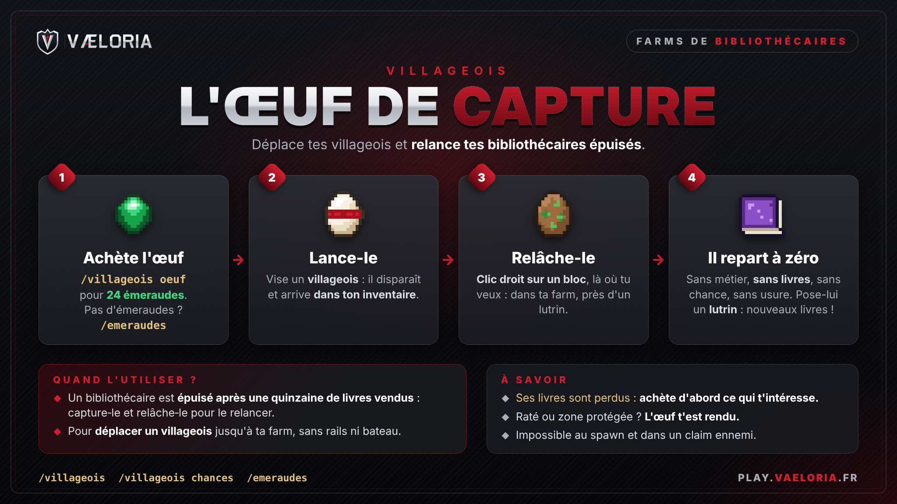

# Affiches en jeu et Discord

| Affiche | Source | Taille |
|---|---|---|
|  | `oeuf-de-capture.html` | 2048 × 1152 (16:9, soit 16 × 9 cartes de 128 px) |

Pour modifier un texte, on édite le `.html`, puis on régénère le PNG avec Chromium en mode headless :

```sh
chromium --headless --hide-scrollbars --window-size=2048,1152 \
  --screenshot="$PWD/oeuf-de-capture.png" "file://$PWD/oeuf-de-capture.html"
```

`logo.png` est une copie de `brand/valoria-logo-horizontal-transparent.png`. Les icônes sont dessinées en pixel art directement dans le HTML.
