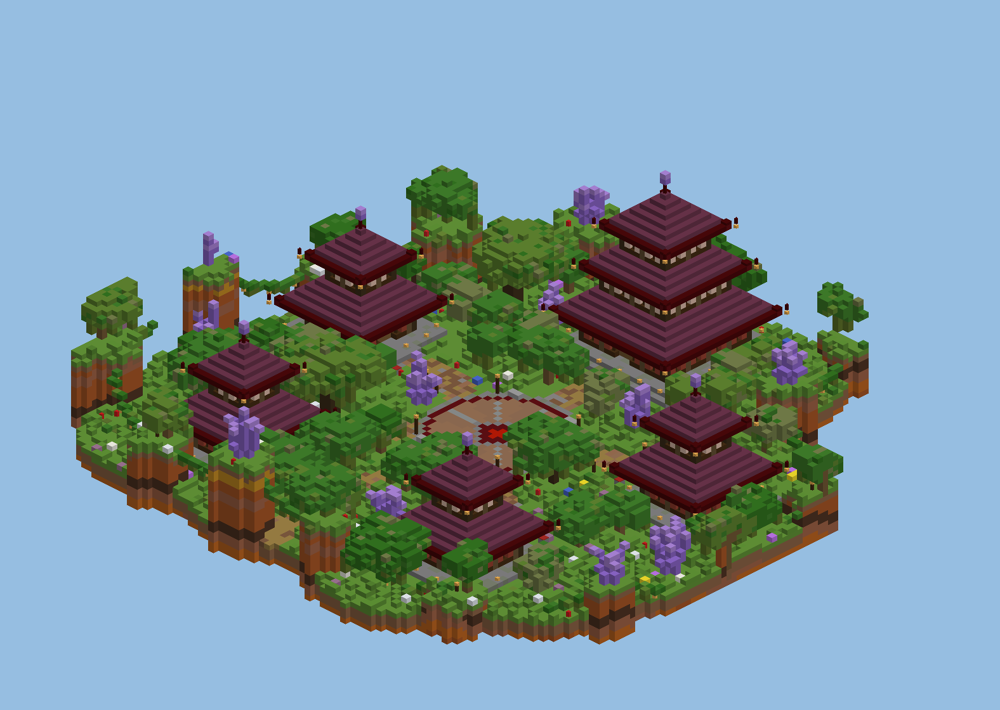
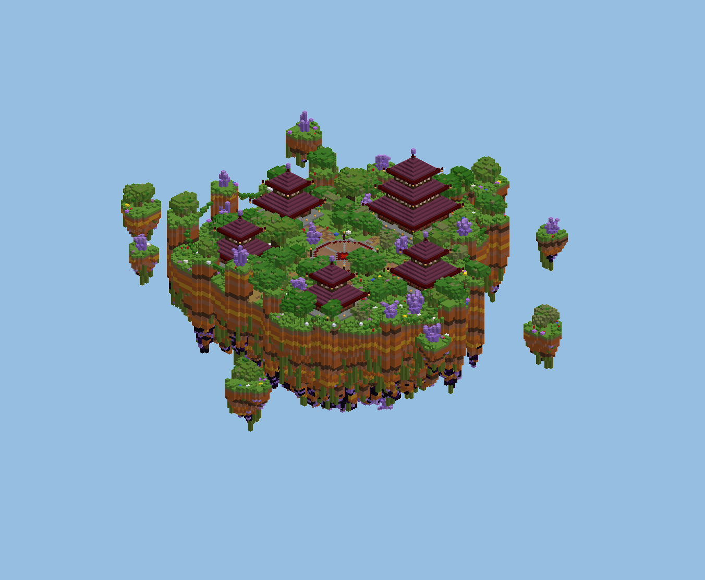
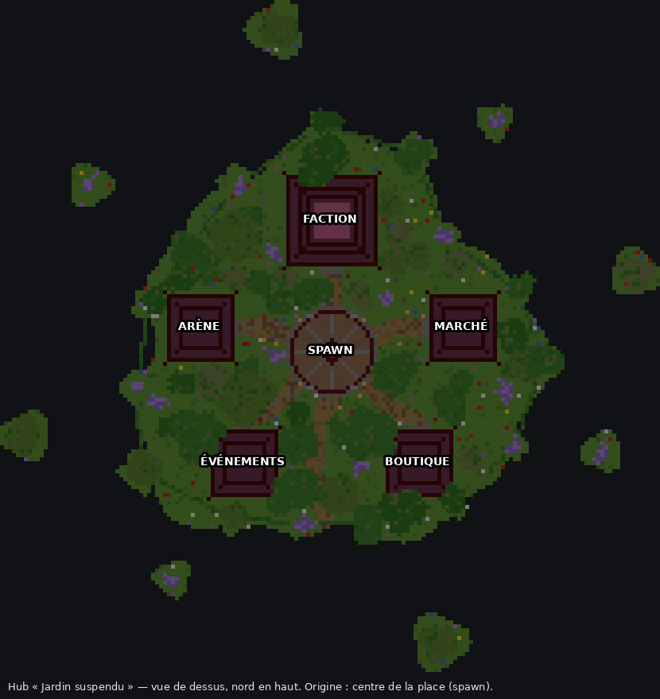

# Hub « Jardin suspendu »

Grande île flottante organique et très végétale (~110 blocs de diamètre, 166 × 107 × 169 avec les îlots). C'est une création originale, générée par script, dans l'esprit des hubs « île flottante luxuriante ».

| Élément | Détail |
|---|---|
| **Falaises** | Strates de terracotta (orange, beige, brun, grès rouge) en colonnes irrégulières. En profondeur, elles virent à l'obsidienne, à l'obsidienne pleureuse et à l'améthyste. Lianes à baies lumineuses, racines et cristaux pendent dessous. |
| **Couronne de colonnes** | 15 colonnes rocheuses de hauteurs variées autour de l'île, surmontées d'un arbre, d'un cristal ou d'une lanterne. Elles sont reliées par des guirlandes de feuillage avec lanternes et baies lumineuses. |
| **Place d'arrivée** (Ø 23) | Dallage en boue tassée et briques de boue, anneau rubis, losange rubis au centre : c'est le point d'apparition. Lampadaires et bancs. |
| **5 pavillons** | Toits carmin bordés de briques rubis, coins retroussés avec lanternes, murs en terracotta rouge et chêne noir, socle en pierre avec escalier. Panneau au-dessus de chaque porte, socle pour PNJ devant. |
| **Chemins** | Terre sinueuse (chemin, terre grossière, boue tassée), lampadaires. Un belvédère part vers le sud. |
| **Végétation** | ~40 arbres touffus (chêne, jungle, azalée fleurie) avec lianes, buissons d'azalée, mousse, herbes, fougères, fleurs (alliums, bleuets, coquelicots…). |
| **Cristaux** | Amas d'améthyste sur l'île, sur les colonnes et sur les îlots, et suspendus sous l'île. |
| **Îlots** | 8 îlots flottants autour de l'île. |

## Pavillons

| Pavillon | Position | Taille |
|---|---|---|
| **FACTION** | nord, face au joueur à l'apparition | grand temple à 3 étages |
| **MARCHÉ** | est (du côté de l'Île Marchande) | 2 étages |
| **ARÈNE** (PvP 1.8, duels) | ouest | 2 étages |
| **ÉVÉNEMENTS** (KOTH, totem, avant-postes) | sud-ouest | 2 étages |
| **BOUTIQUE** (grades, votes) | sud-est | 2 étages |

L'accès aux modes se branche comme tu préfères : un PNJ sur le socle devant chaque pavillon (Citizens / FancyNpcs), ou une région WorldGuard / un plugin de portails sur l'entrée. Pour changer les textes, les positions ou le nombre d'étages, modifie `PAVILIONS` dans `generate.py`.

## Collage

Fichier : `hub-jardin.schem` (Minecraft 1.21.4, WorldEdit / FAWE).

1. Dans un monde vide (void), place-toi au futur centre, les pieds à la hauteur voulue pour le sol.
2. `//schem load hub-jardin` puis `//paste -a`.
3. L'île descend d'environ 72 blocs sous tes pieds et monte d'environ 35 au-dessus. Choisis donc une hauteur de sol d'au moins Y 140.
4. Sur le losange rubis, regarde vers le nord (temple FACTION) et fais `/setworldspawn`.

Conseils : une région WorldGuard `build deny` et `leaf-decay deny` sur le hub (les feuilles sont déjà marquées persistantes), et la téléportation au spawn en cas de chute.

## Régénérer

    python3 generate.py            # schématique + aperçus
    python3 generate.py --no-preview

Le script est déterministe et réutilise les outils de `../ile-commerciale/generate.py`. Les aperçus sont des rendus simplifiés (un bloc = une couleur) : le rendu en jeu est plus riche en textures.
