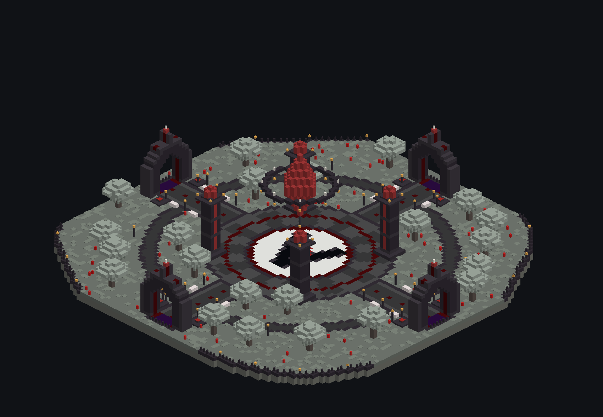
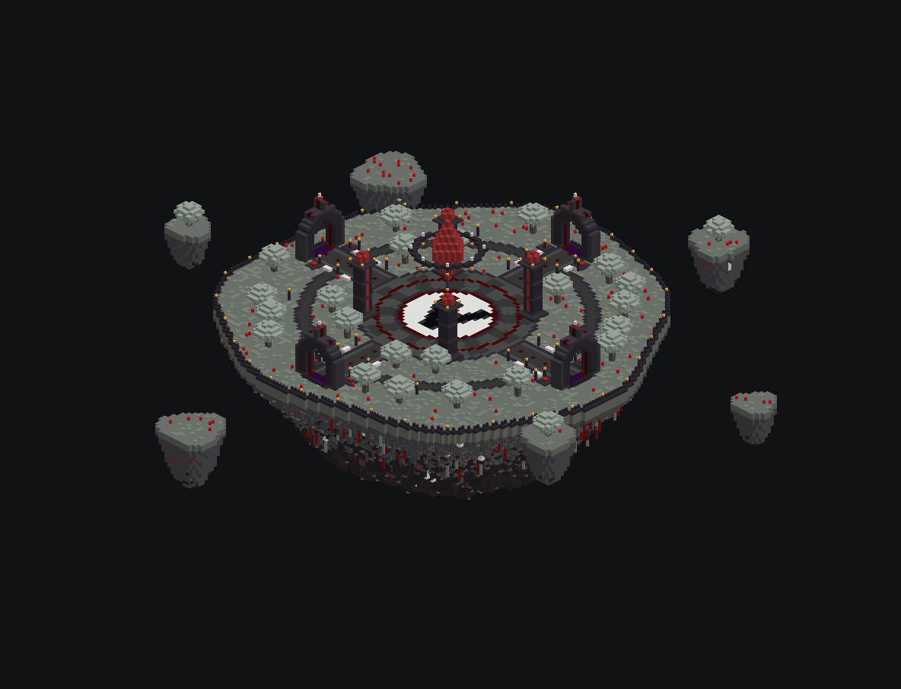
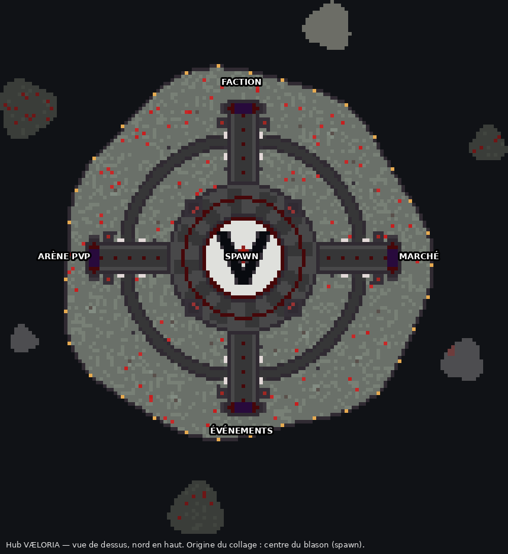

# Hub VÆLORIA

Île flottante circulaire de ~105 blocs de diamètre, dans l'identité visuelle du spawn et de l'Île Marchande : pale moss, tuff, rocher deepslate/blackstone en cône, briques de blackstone polie, pale oaks, accents rubis.

| Élément | Détail |
|---|---|
| **Place centrale** (Ø 43) | Grand blason en V incrusté au sol (calcite, béton noir, losange rubis en bloc de redstone) : c'est le point d'apparition. Dallage rayonnant deepslate, anneaux rubis. |
| **Cristal rubis** | Losange de 18 blocs de haut qui flotte au-dessus du blason (verre rouge, cœur en redstone et shroomlight). Il est entouré d'un anneau suspendu avec des end rods et des lanternes. |
| **4 piliers** | 17 blocs de haut, filets de verre rouge, petit cristal lumineux au sommet. |
| **4 portails en écusson** | Couronne à pointe, ouverture en ogive de 7 × 11, liseré rubis, sol en obsidienne pleureuse (zone de téléportation). Un panneau au-dessus de chaque portail. |
| **Allées** | 7 blocs de large, lampadaires et bancs en pale oak. Une promenade circulaire les relie. |
| **Socles PNJ** | 2 par portail (8 en tout), de part et d'autre de l'entrée, avec un tapis rouge pour poser un PNJ ou un hologramme. |
| **Jardins** | Une vingtaine de pale oaks avec mousse pendante, tapis de mousse, tulipes et coquelicots. |
| **Garde-corps** | Muret sur tout le pourtour, poteau à lanterne tous les 9 blocs. |
| **Îlots** | 6 îlots flottants autour, dont 3 avec un arbre. |

## Portails

| Direction | Portail | Destination prévue |
|---|---|---|
| Nord (en face du joueur à l'apparition) | **FACTION** | Le monde Faction, Saison I |
| Est | **MARCHÉ** | L'Île Marchande, qui se rattache aussi à l'est du spawn |
| Sud | **ÉVÉNEMENTS** | KOTH, totem, avant-postes |
| Ouest | **ARÈNE** | Arène PvP 1.8 / duels (VaeloriaArena) |

Les portails sont décoratifs : il n'y a pas de bloc de portail du Nether, qui disparaîtrait au collage. La téléportation se branche sur la zone en obsidienne pleureuse (3 × 5 blocs dans chaque ogive), au choix :
- une **région WorldGuard** par portail avec une commande d'entrée (ou un plugin de portails : AdvancedPortals, Multiverse-Portals) ;
- ou un **PNJ** sur les socles (Citizens / FancyNpcs) qui lance la commande au clic.

Pour changer le texte des panneaux, modifie `PORTALS` dans `generate.py` et relance le script.

## Collage

Fichier : `hub-vaeloria.schem` (143 × 76 × 150, Minecraft 1.21.4, WorldEdit / FAWE).

1. Dans un monde vide (void), place-toi là où tu veux le centre du hub, **les pieds à la hauteur voulue pour le sol**.
2. `//schem load hub-vaeloria` puis `//paste -a` (`-a` : ne colle pas l'air).
3. Ton point de collage correspond au centre du blason : le rocher descend d'environ 45 blocs sous tes pieds et le cristal monte à ~31 blocs au-dessus. Garde ~50 blocs de marge sous le hub.
4. Reste sur le blason, regarde vers le nord (portail FACTION) et fais `/setworldspawn` (ou `/setspawn` d'EssentialsX).

Conseils : désactiver la chute des joueurs dans le vide (téléportation au spawn), `doDaylightCycle false` à la tombée de la nuit pour profiter des lumières rubis, et une région WorldGuard `build deny` sur tout le hub.

## Régénérer

    python3 generate.py            # schématique + aperçus
    python3 generate.py --no-preview

Le script réutilise les outils de `../ile-commerciale/generate.py` (export Sponge, rocher, pale oaks, aperçus). Il est déterministe : relancé sans modification, il redonne le même fichier.
