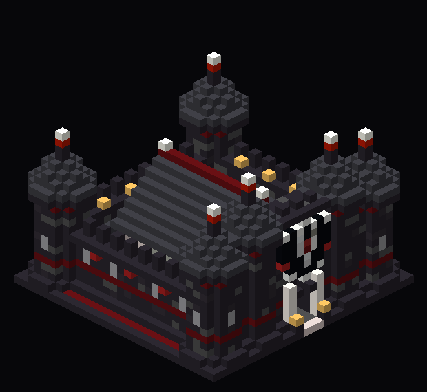

# Bastion de Vælor — zone d'investissement

Une petite forteresse médiévale aux couleurs VÆLORIA. Au centre se trouve la zone d'investissement (AFK), en 9 × 9.



| | |
|---|---|
| Emprise | 29 × 29, parvis compris (le même carré de ±14 que celui réservé au Trésor de Vælor) |
| Hauteur | 24 blocs, épis des tours compris |
| Zone AFK | 9 × 9 au centre : de (-4, 1, -4) à (4, 4, 4) par rapport au point de collage |
| Entrée | à l'ouest, face à la place d'arrivée |

## Ce qu'on y trouve

- **Courtine :** une muraille de 2 blocs d'épaisseur, en pierre noire texturée. Elle a un liseré rubis, un glacis au pied, un chemin de ronde éclairé, des merlons, des meurtrières à barreaux et des bannières rouges sur les façades nord, sud et est.
- **Quatre tours d'angle :** rondes, avec une couronne en encorbellement et un toit conique en deepslate. La base du toit est rubis, et chaque tour est coiffée d'un fleuron noir, d'un bloc de redstone et d'un end rod.
- **Châtelet d'entrée (ouest) :**
  - un bloc relevé entre deux tourelles à toit conique ;
  - un passage de 3 de large en arc brisé, avec des piédroits en quartz et une clé rubis ;
  - une herse levée (seules ses dents dépassent) et des mâchicoulis ;
  - le blason VÆLORIA en relief, entouré de deux bannières ;
  - un seuil en chêne pâle encadré de deux bornes à lanterne.
- **Cour :** pavée de tuf, avec des galeries couvertes en chêne pâle le long des murs nord, sud et est. Elles abritent des bancs, des tonneaux et des lanternes.
- **Halle au centre :** une charpente en chêne pâle sur des socles noirs, avec un toit à deux pans en deepslate, un faîtage rubis et des pignons à colombage en calcite. Un lustre et quatre lanternes pendent sous le toit. Elle couvre la zone AFK, qui forme un damier calcite et quartz cerclé de rubis, avec un sceau en redstone au centre.

La halle n'a pas de murs : on voit la zone de partout et personne ne peut s'y cacher, comme dans le Trésor.

Aperçus : `apercu-3d.png`, `apercu-dessus.png` et `apercu-facade-ouest.png` (la façade vue depuis la place).

## Pose sur le serveur

Il y a deux schématiques. Elles contiennent le même bâtiment, seul le point de collage change :

| Fichier | Point de collage |
|---|---|
| `vaeloria-bastion-invest.schem` | le centre de la zone AFK, au niveau du sol, pour poser le bastion n'importe où |
| `vaeloria-bastion-invest-spawn.schem` | le centre de l'arbre du spawn, au niveau de marche ; le bastion se pose alors en (32, 45), à la place du Trésor de Vælor |

Pour le spawn :

```
//schem load vaeloria-bastion-invest-spawn
//paste
```

N'utilise pas `-a`. Le module est un bloc plein de 29 × 29 × 33 dont l'air efface l'ancien Trésor, et son parvis remplace le sol sur tout le carré. L'allée qui vient de la place arrive pile sur le seuil, au bord ouest du carré (x = 18).

Pour le poser ailleurs, place-toi au centre de la future zone, regard vers l'ouest (côté entrée), puis :

```
//schem load vaeloria-bastion-invest
//paste
```

Il ne faut pas tourner le presse-papiers. Si l'entrée doit regarder ailleurs, utilise `//rotate` avant `//paste`. Les bannières et les escaliers tournent avec le bâtiment.

Réglage de la zone dans le plugin d'investissement : sélectionner de (-4, 1, -4) à (4, 4, 4) autour du point de collage. Dans le spawn, cela donne x 28 → 36, y 1 → 4, z 41 → 49 par rapport au centre de l'arbre.

## Régénérer

```sh
python3 minecraft/investissement/generate.py
```

Le script réutilise `minecraft/spawn/generate.py`, ce qui garantit le même format (Sponge v2, Minecraft 1.21.4) et le même blason.
