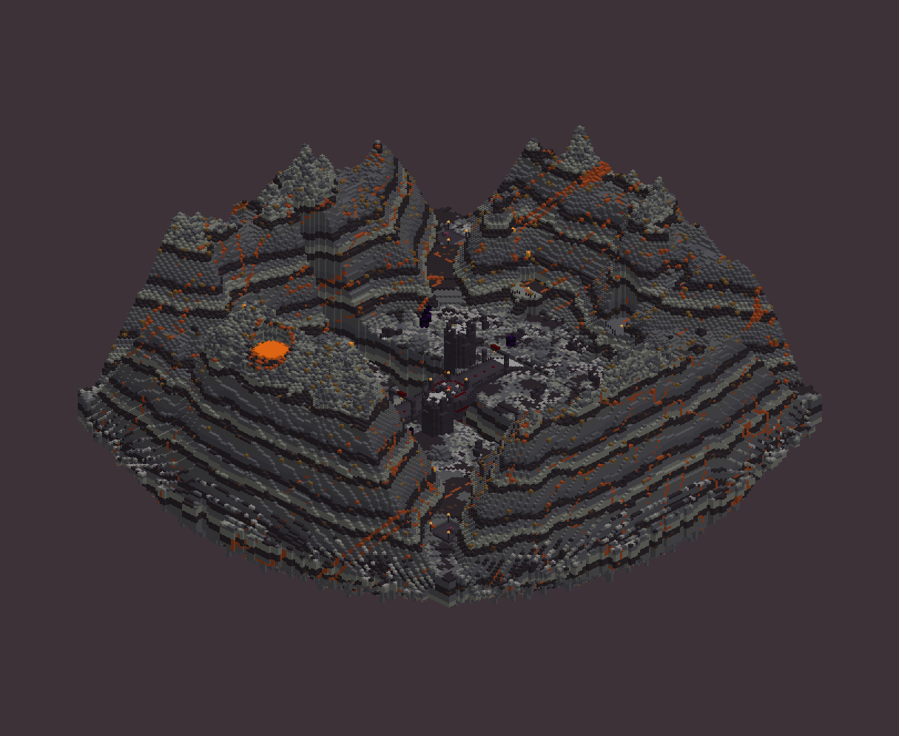
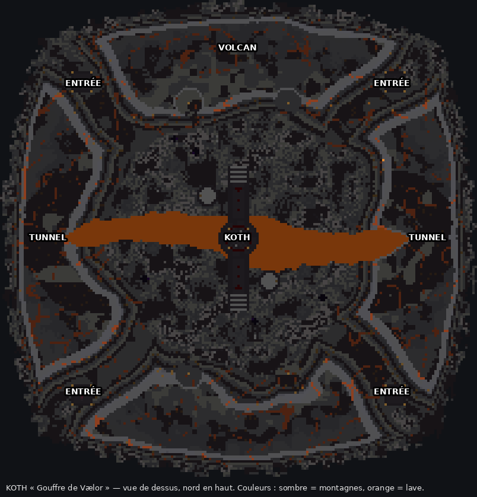
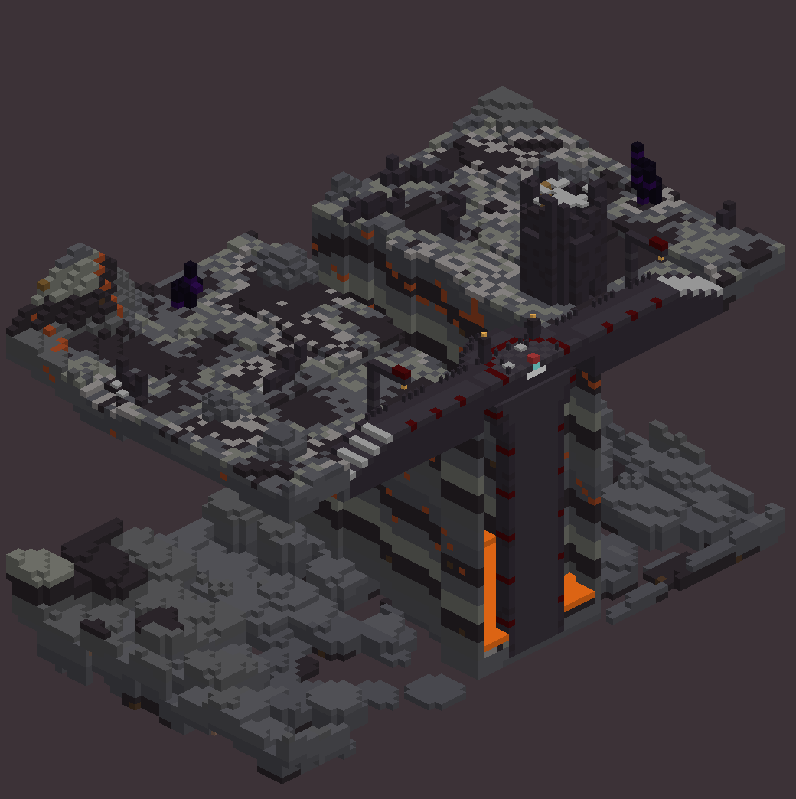

# KOTH « Gouffre de Vælor »

Vallée volcanique d'environ 200 × 200, cernée de montagnes de basalte et de blackstone, et coupée d'est en ouest par un gouffre de lave. La zone de capture est une **plateforme ronde au milieu du pont** qui franchit le gouffre. Elle est posée sur un pilier qui monte de la lave, 43 blocs plus bas.

## Gameplay

| Élément | Détail |
|---|---|
| **Zone de capture** | Plateforme de 17 blocs de diamètre au centre du pont. La zone est l'anneau rubis (rayon 5). Couverts : 4 murets bas, 4 piliers brisés, garde-corps percé (on peut tomber ou être poussé). Une balise envoie un faisceau rouge visible de toute la vallée. |
| **Pont** | 9 de large, garde-corps bas avec des trous, arches en ruine aux deux têtes de pont, rampes d'accès. |
| **4 entrées** | 4 cols sinueux (NO, NE, SO, SE) qui descendent des montagnes vers la vallée. Une plateforme d'arrivée est au bout de chacun (lanternes, panneau). |
| **Gouffre** | La vallée est coupée en deux. Pour passer de l'autre côté, il faut le pont (donc la zone KOTH) ou un tunnel. |
| **2 tunnels** | Est et ouest, creusés dans les montagnes. Ils contournent les extrémités du gouffre pour prendre à revers (4 de large, éclairés). |
| **Hauteurs** | 2 tours en ruine aux têtes de pont, au nord-ouest et au sud-est (échelle intérieure, plate-forme crénelée à +16, meurtrières). 4 corniches sur les flancs nord et sud, à +9 ou +13, avec une rampe et un muret. |
| **Couverts** | Rochers de basalte, murs en ruine, éclats d'obsidienne dispersés dans la vallée. |
| **Décor** | Volcan au nord avec un cratère de lave, filons de magma, fumerolles (feux de camp à fumée), sommets en tuf. |

## Collage

Fichier : `koth-volcan.schem` (201 × 141 × 201, Minecraft 1.21.4, WorldEdit / FAWE).

1. Dans un monde vide (void), place-toi là où tu veux le centre de la zone de capture, les pieds au niveau du sol. Prévois environ **70 blocs de vide en dessous** et 70 au-dessus (par exemple, pieds à Y 120).
2. `//schem load koth-volcan` puis `//paste -a`.
3. Tu es au centre de la zone, juste à côté de la balise.

## Coordonnées utiles (par rapport au point de collage)

| Quoi | Décalage X / Y / Z |
|---|---|
| Zone de capture (région) | de −5 / 0 / −5 à +5 / +4 / +5 |
| Arrivée nord-ouest | −66 / +2 / −66 |
| Arrivée nord-est | +66 / +2 / −66 |
| Arrivée sud-ouest | −66 / +2 / +66 |
| Arrivée sud-est | +66 / +2 / +66 |
| Fond de la vallée | Y −3 |
| Surface de la lave | Y −43 |

Pour la zone : debout sur le point de collage, `//pos1 ~-5 ~ ~-5` puis `//pos2 ~5 ~4 ~5`, et crée la région de ton plugin KOTH (ou une région WorldGuard). Les plateformes d'arrivée servent de points de téléportation au début de l'événement, une faction par entrée.

Conseils :
- une région WorldGuard `build deny` sur toute la map ;
- `lava-fire deny` et `fire-spread deny` ;
- garder le PvP actif partout.

## Régénérer

    python3 generate.py            # schématique + aperçus
    python3 generate.py --no-preview

Le script est déterministe. Les réglages principaux sont en tête de `generate.py` : taille, hauteur du pont, angles des cols. Le gouffre se règle dans `chasm_w`, `chasm_floor` et `chasm_c`. Les aperçus sont des rendus simplifiés (une couleur par bloc). Sur la coupe, l'intérieur creux des montagnes est normal : il est invisible en jeu.
