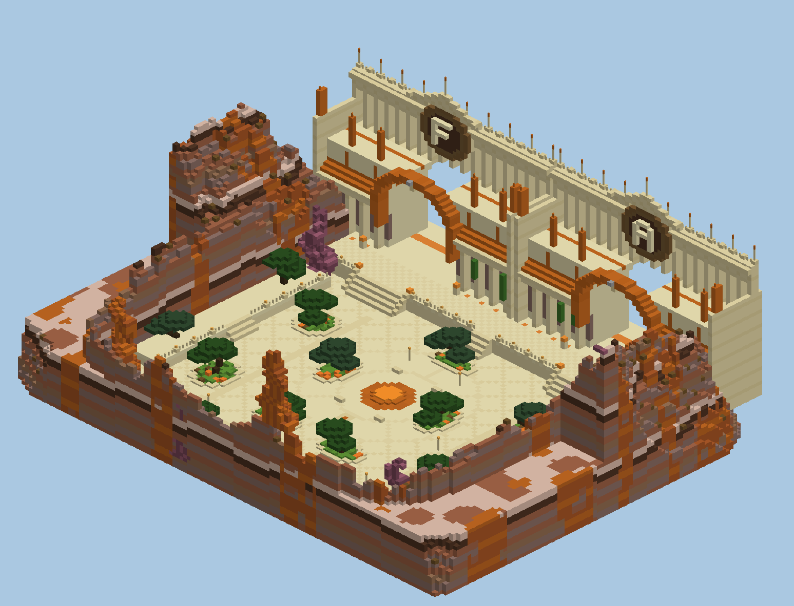
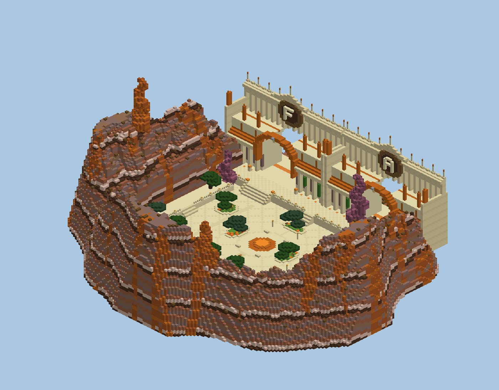

# Spawn « Canyon des Arches »

Cour-jardin au fond d'un canyon, dominée par deux façades monumentales en grès. Chaque façade est percée d'une grande arche qui sert de portail. C'est une création originale générée par script, dans le style des spawns « cité de grès ».

| Élément | Détail |
|---|---|
| **2 façades** (55 blocs de large chacune, ~50 de haut) | Colonnade en grès taillé avec chapiteaux ciselés, fenêtres hautes, corniche, grand toit de tuiles orange (grès rouge), galerie d'arcades ajourée au-dessus, balustrade, pinacles. Pilastres d'angle couronnés de grès rouge, flèches orange sur le toit, lierre sur certaines colonnes. |
| **2 grandes arches** (19 de large, ~24 de haut) | Arc en claveaux de grès rouge alternés, clé de voûte, seuil lumineux (verre orange sur shroomlight). Ce sont les portails **FACTION** (ouest) et **ARÈNE** (est), avec un panneau au-dessus. |
| **Médaillons** | Disque en bois d'épicéa et terracotta brune avec la lettre du mode (F, A), sous une couronne à volutes et une flèche. |
| **Terrasse** | Devant les façades, 4 blocs au-dessus de la cour. Trois grands escaliers, balustrade avec lanternes, braseros (feux de camp) aux escaliers, lumière orange au pied des colonnes. |
| **Cour** | Dallage en grès à losanges, anneaux et rayons autour d'un foyer central qui brûle en permanence (netherrack). 11 jardinières avec des arbres taillés façon bonsaï (chêne noir, épicéa), tulipes orange, fougères, bancs, lampadaires. |
| **Terrasses latérales** | À l'est et à l'ouest, avec escalier, balustrade et arbres. |
| **Canyon** | Falaises en strates de terracotta (brun, gris, blanc, boue tassée) avec des filons orange. Elles montent jusqu'à ~48 blocs au-dessus de la cour, avec des pics rocheux orange et violets. L'ensemble est une île : le dessous descend en cône. |

## Collage

Fichier : `spawn-canyon.schem` (149 × 117 × 128, Minecraft 1.21.4, WorldEdit / FAWE).

1. Dans un monde vide (void), place-toi là où tu veux le point d'apparition, les pieds à hauteur du sol de la cour. Prévois ~50 blocs de vide en dessous et ~70 au-dessus.
2. `//schem load spawn-canyon` puis `//paste -a`.
3. Tu es sur la marque en grès ciselé au sud du foyer, face aux arches : fais `/setworldspawn` en regardant vers le nord.
4. Branche les portails sur les deux arches : région WorldGuard ou plugin de portails sur le seuil lumineux, ou un PNJ au pied de chaque escalier.

Pour changer les lettres et les textes, ou ajouter une façade, modifie `FACADES` et `LETTERS` dans `generate.py`, puis relance `python3 generate.py`. Les aperçus sont des rendus simplifiés (une couleur par bloc).
